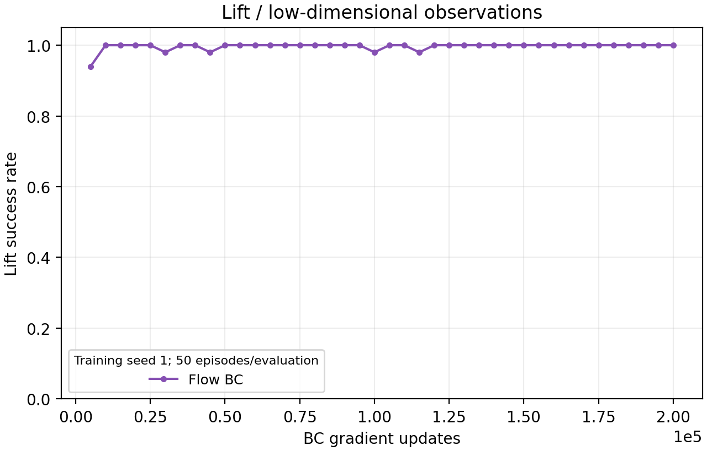
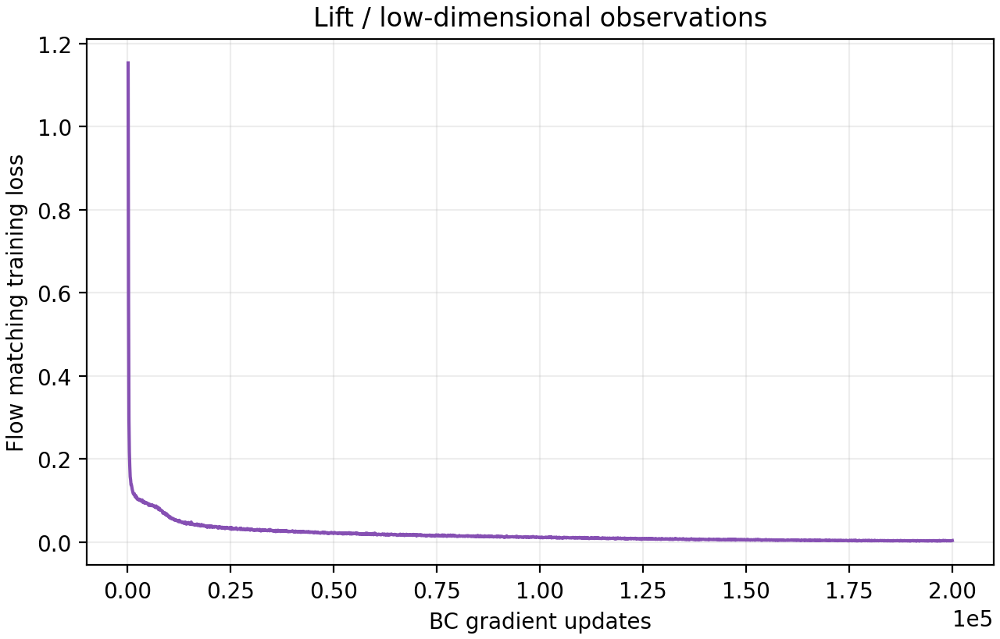

# Flow Matching BC: Lift, 2000 Epochs

> **Historical experiment: v1.4.1 / v141 data.** These results and artifacts are preserved for provenance. For current v15 models and curves, see [the current results](../lift_flow_v15/README.md). The 100/100 independent result below belongs to this historical model.

The final checkpoint achieved **100/100 successes (100%)** in independent evaluation, with a mean rollout length of **43.88 environment steps**. This is one trained policy evaluated with five random seeds, not five training runs.

| Setting | Value |
|---|---|
| Task / observations | Lift / low-dimensional state |
| Dataset | robomimic proficient-human (`ph`), `low_dim_v141.hdf5`, 200 demonstrations |
| Training seed | 1 |
| Training budget | 2000 epochs, 100 updates per epoch, batch size 100 |
| Final in-training evaluation | 50/50 successes; mean horizon 44.02 |
| Independent evaluation | Seeds 1000–1004, 20 episodes each, horizon 400 |
| Independent successes by seed | 20, 20, 20, 20, 20 |
| Checkpoint selection | Final epoch 2000 |
| Checkpoint SHA256 | `d1ef3ccbd630e7df928a97b2aa608489f782096e740d01e75bfc14163458984d` |

Training was interrupted during the epoch-350 evaluation and resumed from the last complete epoch-349 checkpoint. The continuation completed at epoch 2000. Later complete log entries replace duplicated epochs in the exported metrics. Resume may change the RNG sequence relative to an uninterrupted run.

## Learning curves

The horizontal axis is **BC gradient updates**, not environment interaction steps. Each success-rate point uses 50 evaluation episodes. There is only one training seed, so no cross-training-seed confidence band is shown.

## Files

- [Independent evaluation by seed](independent_evaluation.csv)
- [Independent evaluation summary](independent_summary.json)
- [Training evaluation metrics](evaluation_metrics.csv)
- [Training loss and learning-rate metrics](training_metrics.csv)
- [Training report metadata](training_summary.json)
- [Success curve PDF](lift_success.pdf)
- [Loss curve PDF](training_loss.pdf)
- [Final training evaluation video](Lift_epoch_2000.mp4)

The video is from the epoch-2000 in-training evaluation. The separate independent 100-episode evaluation did not record video. A 100/100 result describes these trials and does not guarantee success for every future initial condition.

The original run artifacts remain on Oscar under `results/flow_aligned_train_8357773/` and `results/flow_final_eval_8401742/`. Dataset and model weights are excluded from Git.

See [implementation and reproduction instructions](../../../FLOW_POLICY.md) and the [paired Flow configuration](../../../experiments/configs/flow/lift_low_dim.json). No Diffusion comparison result is included yet.
