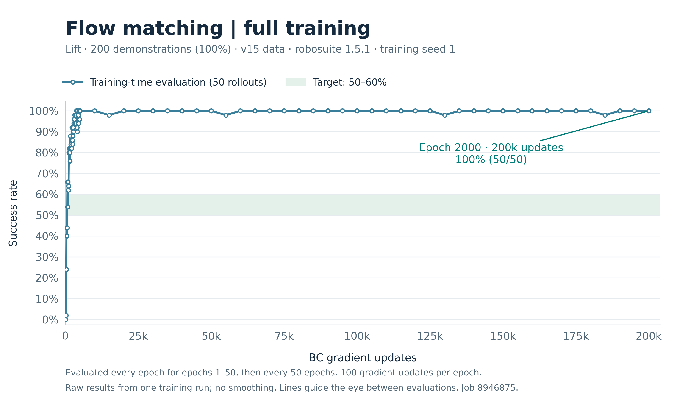
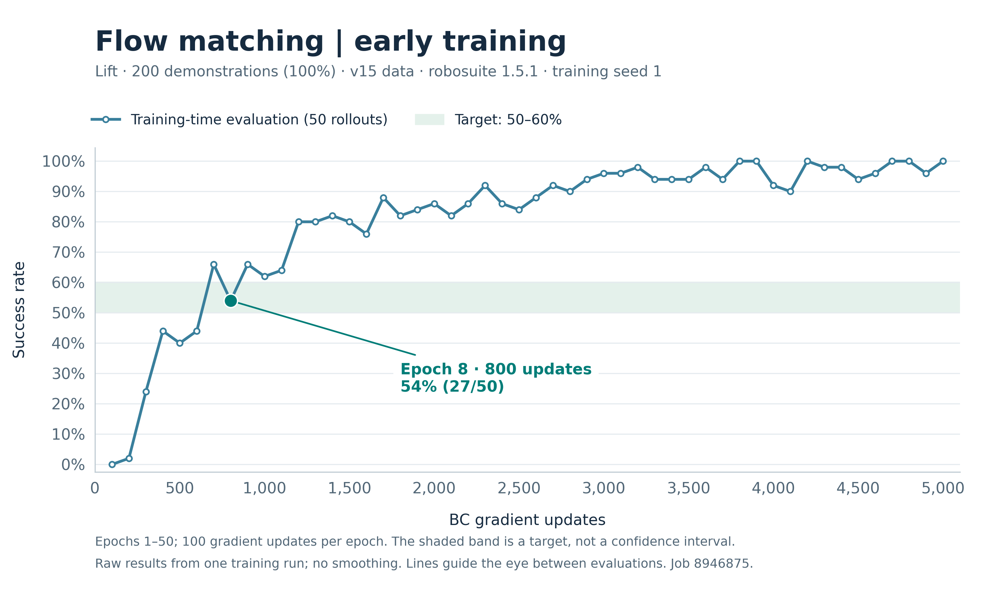
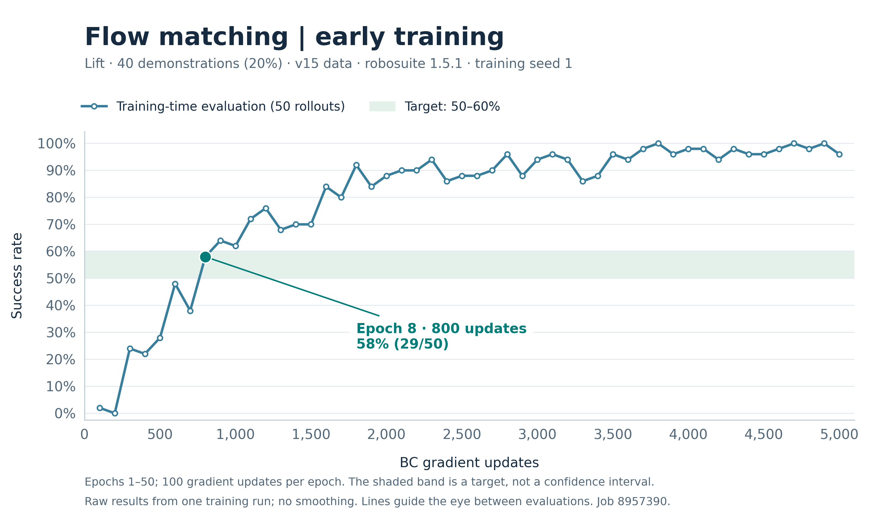

# Current Flow Matching results: Lift v15

Separate full-data (200 demos, job 8946875) and 20%-data (40 demos, job 8957390) runs. Both use seed 1, 2000 epochs x 100 BC gradient updates, batch size 100, EMA, horizons 2/16/8, and 10 Euler inference steps. Environment: robosuite 1.5.1, MuJoCo 3.2.3. Data: low_dim_v15.hdf5. Exact configurations and versions are linked from the model directories.

| Dataset | Epoch 50 | Subsequent evaluated points through epoch 2000 | Epoch 2000 |
|---|---:|---:|---:|
| 100%, 200 demos | 100% | 98–100% | 100% (50/50) |
| 20%, 40 demos | 96% | 94–100% | 100% (50/50) |

Training-time evaluation uses 50 rollouts, horizon 400. Epochs 1–50 are evaluated individually, then every 50 epochs, giving 89 points per run. Curves show raw results without smoothing; the horizontal axis is BC gradient updates. These are single-training-seed results. Neither final v15 checkpoint has a reported independent evaluation.

## Full-data models and curves

[Download early/final models](../../../pretrained_models/lift_flow_v15_full_seed1/README.md) · [Evaluation CSV](full/evaluation_metrics.csv)

Epoch 8: 54% (27/50) at 800 gradient updates. Independent frozen-model evaluation: **54/100**, seeds 1000–1004, 20 episodes per seed. [Independent evaluation CSV](full/epoch8_independent_evaluation.csv). This is five evaluation seeds for one trained model, not five training runs.

## 20%-data models and curves

[Download early/final models](../../../pretrained_models/lift_flow_v15_20pct_seed1/README.md) · [Evaluation CSV](20pct/evaluation_metrics.csv)

Epoch 8: **58% (29/50)** at 800 gradient updates. Independent evaluation is pending. The 40 demonstration IDs are recorded in the published subset.json.

## Provenance and historical results

CSVs were supplied as complete Oscar log extracts by the experiment owner. Figures were generated from those values, with editable SVGs and reproducible plotting scripts alongside the PNGs. The full-data epoch-8 independent CSV also came from the owner's evaluation output. Weight bytes and configuration are verified separately by the model upload process and SHA256SUMS.

The older v1.4.1/v141 experiment, including its independent 100/100 result and videos, is retained in the [historical report](../lift_flow_seed1_2000/README.md). Its measurements are not substituted into the current curves. The separate 20%-data model Release and directory are preserved.
