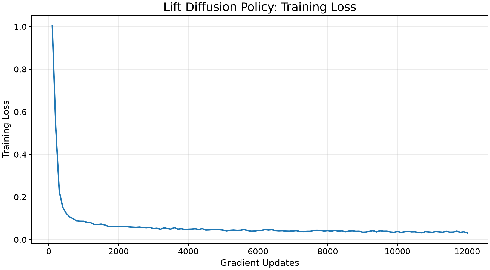
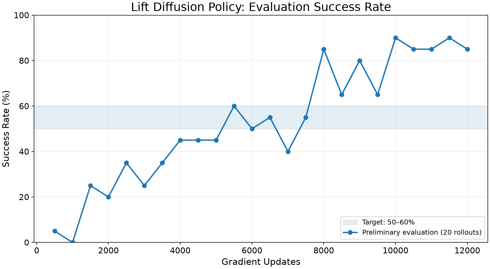
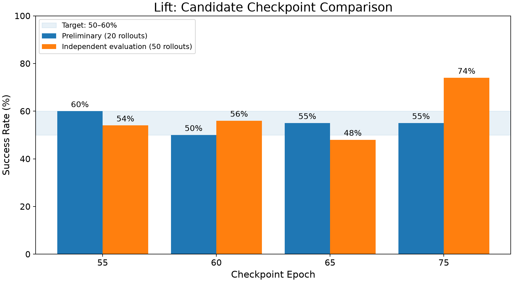

# Lift Diffusion Policy: Early Checkpoint Study

This study identifies partially successful behavior cloning policies for subsequent Q2RL
reinforcement learning experiments. The current recommendation is **epoch 60: 56% success
(28/50 rollouts)**, with **epoch 55: 54% (27/50)** as an alternative. These are candidate
initial policies, rather than claims of optimal policy performance.

Experiment contributor: Chengming Peng. This directory complements the existing
[Lift and Can baselines](../../README.md); their configuration files, videos, and results
remain unchanged.

## Research Motivation

The next experiment asks whether reinforcement learning can improve an initial behavior
cloning policy with approximately 50–60% task success. A policy in that range leaves room
to measure improvement and exposes meaningful failures. The existing 98% baselines serve
a different purpose: they demonstrate high behavior cloning performance and have less
remaining success-rate headroom.

This study does not establish a reinforcement learning improvement: no reinforcement
learning fine-tuning has been evaluated here.

## Experimental Setup

| Setting | Value |
|---|---|
| Algorithm | Diffusion Policy, behavior cloning |
| Environment | robosuite `Lift`, Panda robot, `OSC_POSE` controller |
| Demonstrations | Proficient-human (`ph`), low-dimensional v1.5 dataset |
| Dataset file | `lift/ph/low_dim_v15.hdf5` |
| Observation keys | `robot0_eef_pos`, `robot0_eef_quat`, `robot0_gripper_qpos`, `object` |
| Training seed | 1 |
| Preliminary evaluation | 20 rollouts every 5 epochs |
| Independent candidate evaluation | 50 rollouts per checkpoint; explicit seed 123 |
| Rollout limit | 400 environment steps; terminate on success |

Here, **independent evaluation** means a separate evaluation invocation after training,
not an assertion that all reported experiments use independent random seeds. All four
candidate evaluations use seed 123. Training-time evaluation uses the training run's
random-number history; no separate training-time rollout seed is recorded.

## Training Configuration

The published [config.json](config.json) comes from the actual
`lift_dp_fixed_120.json` used for this run. Only `train.output_dir` was changed to the
portable relative path `experiments`. All other source configuration values are retained.
In particular, `train.data` is `null` in the source file: the original launch script supplied
the dataset through `--dataset`. The configuration printed in the training log agrees
with the source config except for the resulting dataset entry.

| Parameter | Value |
|---|---|
| Epochs / updates per epoch / total updates | 120 / 100 / 12,000 |
| Batch size | 16 |
| Optimizer | AdamW; L2 regularization `1e-6` |
| Initial learning rate | `1e-4` |
| Learning-rate schedule | Cosine, 500 warmup steps, 0.5 cycles; step every batch |
| Observation / action / prediction horizon | 2 / 8 / 16 |
| Frame stack / sequence length | 2 / 16 |
| UNet down dimensions | 256, 512, 1024 |
| Diffusion schedule | DDPM, 100 training and 100 inference steps, `squaredcos_cap_v2` |
| Prediction target | Noise (`epsilon`); sample clipping enabled |
| EMA | Enabled, power 0.75 |
| Observation / action normalization | Disabled / none |
| Checkpoint policy | Every 5 epochs and on best rollout success rate |

The training log also records `last.pth` and `last_bak.pth` saves. Periodic checkpoint names
can include a success-rate suffix; use the exact filenames in the availability table below.

### Software verification status

| Component | Status for this experiment |
|---|---|
| RoboMimic | 0.5.0 reported by the experiment owner; installed version and source commit unverified |
| PyTorch | Exact version unverified |
| robosuite | Exact version unverified |
| MuJoCo | Exact version unverified |
| Python / diffusers / CUDA | Exact versions unverified |

The supplied archive contains configuration files, logs, figures, data, and launch scripts,
but no environment lockfile or package-version inventory. Versions from the existing
Lift/Can README or the repository's vendored source must not be substituted for this run's
environment. Exact environment reproduction remains pending an inventory from the original
research environment.

## Learning Curves

The CSVs were checked numerically against every corresponding logged value: 120 training
loss rows and 24 preliminary evaluation rows. Gradient updates equal epoch × 100. The
figures below are regenerated from those verified tables with readable labels; the
downloaded original figures are retained in the source archive.

### Training Loss vs Gradient Updates

The epoch-120 training loss is **0.0316474652**. Training loss describes the behavior
cloning objective and does not by itself establish task success.

### Evaluation Success Rate vs Gradient Updates

Each point uses 20 rollouts. At epoch 120, preliminary success is **85% (17/20)**.
This is not a separate 50-rollout evaluation of the final model. Success varies during
training even as training loss broadly decreases.

Data: [training_loss.csv](data/training_loss.csv) and [success_rate.csv](data/success_rate.csv).
Success-rate columns are fractions in [0, 1]; figures and tables display percentages.

## Candidate Checkpoint Selection

The preliminary results identified epochs 55, 60, 65, and 75 for separate evaluation.
The 50-rollout results place epochs 55 and 60 within the target range. Epoch 60 is the
current working choice because it meets that experimental objective; it is not the best
checkpoint in terms of maximum observed success. Epoch 55 is a suitable backup.

## Independent Evaluation Results

| Epoch | Gradient updates | Preliminary (20 rollouts) | Independent (50 rollouts) | Independent successes | Interpretation |
|---|---|---|---|---|---|
| 55 | 5,500 | 60% (12/20) | 54% | 27/50 | Backup candidate |
| **60** | **6,000** | **50% (10/20)** | **56%** | **28/50** | **Current recommendation** |
| 65 | 6,500 | 55% (11/20) | 48% | 24/50 | Below the target in this evaluation |
| 75 | 7,500 | 55% (11/20) | 74% | 37/50 | Above the target in this evaluation |

Data: [verified_checkpoints.csv](data/verified_checkpoints.csv).

With 20 rollouts, one success changes the estimate by 5 percentage points; with 50, it
changes it by 2 points. The one-success difference between epochs 55 and 60 does not
establish a statistically significant difference in underlying performance.

Epoch 75 changes from 55% to 74% across two evaluation batches of the same checkpoint.
This illustrates the instability of selecting policies from small rollout samples.
Sampling variation and different evaluation random-number histories can contribute;
these logs do not isolate their contributions. The result is not evidence that the
checkpoint improved between evaluations, nor does it prove that sampling variation is
the only cause. More rollouts and additional seeds are needed before stronger conclusions.

## Rollout Visualization

[Open or download the original epoch-60 rollout video](videos/lift_epoch60_8923795.mp4).

| Video sample | Recorded value |
|---|---|
| Checkpoint | Epoch 60 |
| Rollouts / seed | 5 / 123 |
| Sample successes | 2/5 (40%) |
| Mean rollout horizon | 262.4 environment steps |
| Encoding | H.264 MP4, 512 × 512, 20 FPS |
| Frames / duration | 263 / 13.15 seconds |
| Rendering | `agentview`, `video_skip=5` |

This five-rollout recording is for visualization. **Use 56% (28/50), not 40% (2/5), as
the independent epoch-60 evaluation result.** The MP4 is preserved byte-for-byte from
the supplied archive, including failures. No per-rollout success labels were inferred
from appearance. At `video_skip=5`, playback timing differs from real-time simulation.

## Reproducibility

See [scripts/README.md](scripts/README.md) for commands to:

- Rebuild and verify all three CSVs from the original logs, which remain local.
- Regenerate all three figures from the published CSVs without training or simulation.
- Reproduce training, candidate evaluation, or the five-rollout video when the original
  environment, dataset, and checkpoints are available.

The portable runner changes only the dataset and output locations when constructing a
temporary training configuration. It preserves the training parameters and records the
original evaluation flags. Its `--dry-run` option prints commands without starting work.
No training, simulation, or GPU jobs were run when preparing this contribution.

The adapters have been checked against the archived launch commands and repository CLI
definitions; CSV extraction and figure regeneration have been executed locally. End-to-end
model execution has not been repeated, and compatibility with the original environment
remains subject to the software-version limitation above.

## Limitations and Next Steps

- This is one training run and a small candidate set, selected using preliminary results.
  Candidate selection can introduce selection bias.
- Fifty evaluation rollouts still carry substantial uncertainty. Additional rollout seeds
  and training seeds are needed; no significance claim is made for epochs 55 versus 60.
- The existing Lift/Can experiments use 2,000 epochs, 200,000 updates, batch size 100,
  and report 98% success over 50 episodes. This run uses 120 epochs, 12,000 updates, and
  batch size 16. Training duration, batch size, and potentially software configuration
  differ, so these are complementary baselines rather than a controlled algorithm comparison.
- First recover an environment inventory and verify checkpoint availability, then evaluate
  the selected initial policies more broadly before Q2RL fine-tuning.
- Any Q2RL improvement must be measured in a subsequent experiment; it is not a result
  of this contribution.

## Data and Model Availability

This directory publishes the portable training config, three CSVs, three PNGs, the original
MP4, and reproducibility scripts. [provenance.json](data/provenance.json) records source
file hashes, verification scope, and software-version gaps without publishing private paths.

The training log records the following checkpoint files under the original experiment's
`models/` directory:

| Epoch | Checkpoint basename |
|---|---|
| 55 | `model_epoch_55_low_dim_v15_success_0.6.pth` |
| 60 | `model_epoch_60.pth` |
| 65 | `model_epoch_65.pth` |
| 75 | `model_epoch_75.pth` |

The experiment directory relative to the research project is
`Work/experiments/lift_dp_fixed_120/20261111081503/`. Checkpoints remain in the original
research storage; they were not included in this import and their present availability
has not been checked. No model weights, HDF5 datasets, full logs, environments, credentials,
or private absolute paths are committed. Coordinate with the team for checkpoint access
and an approved hosting location before publishing weights. Dataset acquisition follows
the [existing project dataset instructions](../../README.md#datasets).
